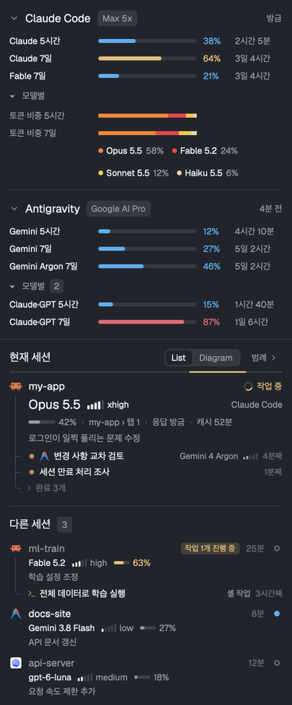
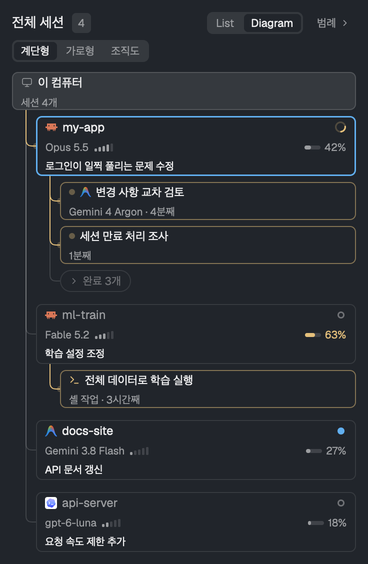

# Herdr Agent Panel

[English](README.md) | **한국어**

Herdr 데스크톱 앱의 오른쪽 패널에 **AI 사용량**과 **세션별 모델 현황**을 한눈에 보여 주는 mod 모음입니다. Claude Code와 Antigravity(agy)를 함께 쓰는 사람을 위해 만들었습니다.

> 화면 글자는 macOS 언어 설정을 따릅니다. 선호하는 언어 목록의 첫 번째가 한국어면 한국어로, 그 밖에는 영어로 표시됩니다.



세션 목록을 **Diagram**으로 바꾸면 같은 세션과 각 세션이 띄운 작업을 지도처럼 볼 수 있습니다. 배치는 헤더 아래 버튼으로 계단형(아래 사진)·가로형·조직도 중에서 고를 수 있습니다.



## 들어 있는 mod

| mod | 하는 일 |
|---|---|
| [`ai-usage`](ai-usage/) | Claude Code의 5시간·7일 한도와 모델별 주간 한도(예: Fable), Antigravity의 Gemini·Claude/GPT 한도를 막대로 보여 줍니다. "모델별"을 펼치면 모델별 토큰 비중도 볼 수 있습니다. 섹션 제목을 누르면 제목 한 줄만 남기고 접힙니다. Claude Code나 agy를 꺼 두어도 두 섹션 모두 계속 갱신됩니다. |
| [`sessions`](sessions/) | 지금 보고 있는 세션의 모델·추론 강도·컨텍스트 사용률을 크게 보여 주고, 다른 세션과 각 세션이 실행 중인 하위 에이전트를 트리로 보여 줍니다. 세션마다 지금 무엇을 하고 있는지 한 줄로 표시하고, 하위 에이전트는 상위 세션과 모델이 다를 때만 모델을 따로 표시합니다. 에이전트가 답변을 마친 뒤에도 백그라운드에서 실행 중인 작업(예: 학습 스크립트)이 있으면 따로 표시합니다. List에서 Diagram으로 바꾸면 같은 내용을 상자와 선으로 보여 주며, 배치는 세 가지 중에서 고를 수 있습니다. |
| [`tabs-flow`](tabs-flow/) | Herdr 기본 탭 바에 **Flow** 버튼을 더하고, 어느 스페이스로 전환하든 이 패널이 자동으로 열리게 합니다. |

세 개를 함께 쓰도록 만들었지만, 각각 따로 설치해도 됩니다.

## 요구 사항

- Herdr 데스크톱 앱 0.1.16에서 개발하고 동작을 확인했습니다.
- macOS(`stat -f`, `ps` 등 macOS 명령을 씁니다), `python3`, `jq`
- `ai-usage`
  - Claude Code(Pro·Max 구독): 사용량은 구독 요금제에서만 표시됩니다.
  - Antigravity 섹션은 Antigravity CLI(`agy`)가 설치되어 있을 때만 표시됩니다. 패널이 홈 폴더에서 agy에 사용량을 물어보므로, agy가 홈 폴더를 신뢰해야 합니다. 홈 폴더에서 `agy`를 한 번 실행해 폴더를 신뢰하도록 선택해 두세요.
- `sessions`: 모델·추론 강도·하위 에이전트 정보는 [herdr-over9k](https://github.com/herunan/herdr-over9k) 사이드바가 생성하는 캐시에서 읽어 오므로, over9k 사이드바를 미리 설치해 두어야 합니다.

## 설치

1. mod 폴더를 Herdr 설정 경로(`~/.config/herdr-app/mods/`)로 복사합니다.

   ```sh
   cp -R ai-usage/mods/ai-usage sessions/mods/sessions tabs-flow/mods/tabs-flow ~/.config/herdr-app/mods/
   ```

2. 개인 레이아웃에 패널을 추가합니다. Herdr 기본 레이아웃은 직접 수정할 수 없으니 먼저 복제합니다.

   ```sh
   herdr-app do layout.clone '{"name":"main","as":"my-main"}'
   ```

   `~/.config/herdr-app/layouts/my-main.json`에서 두 곳을 고칩니다.

   - 탭 바: `"id": "tabs"` 블록의 `"mod": "tabs"`를 `"mod": "tabs-flow"`로 바꿉니다.
   - 패널: `"id": "panel-body"` 스택의 `children`에 아래 노드를 추가합니다.

   ```json
   { "id": "flow", "type": "column", "children": [
     { "id": "usage", "type": "block", "content": { "mod": "ai-usage" }, "size": { "px": 330 } },
     { "id": "flow-main", "type": "block", "content": { "mod": "sessions" }, "size": { "weight": 1 } } ] }
   ```

   위 설정에는 초기값으로 `"px": 330`이 들어가지만, 실제로는 `usage` 블록의 높이가 내용에 맞춰 자동으로 조절됩니다.

   언어를 직접 정하려면 `usage`와 `flow-main` 블록의 `content` 안, `"mod"` 옆에 `"props": { "lang": "ko" }`(영어는 `"en"`)를 넣으세요. 예: `"content": { "mod": "ai-usage", "props": { "lang": "ko" } }`

3. (선택) 상태줄 스크립트를 설정합니다. `ai-usage`는 Claude Code와 agy에 사용량을 직접 물어보므로, 스크립트는 설정하지 않아도 됩니다. 설정해 두면 열려 있는 세션이 갱신될 때 막대도 바로 바뀌고, Antigravity 섹션에 요금제 이름도 표시됩니다.

   - **Claude Code**: [`extras/claude-statusline-usage.sh`](ai-usage/extras/claude-statusline-usage.sh)를 `~/.claude/`에 복사하고, `~/.claude/settings.json`에 다음을 넣습니다. 이미 사용 중인 상태줄 스크립트가 있다면, 스크립트 맨 앞에서 표준 입력(stdin)을 `~/.claude/state/statusline-latest.json`에 저장하는 부분만 기존 스크립트에 추가해도 됩니다.

     ```json
     "statusLine": { "type": "command", "command": "~/.claude/claude-statusline-usage.sh", "refreshInterval": 30 }
     ```

   - **Antigravity**: [`extras/agy-statusline-usage.sh`](ai-usage/extras/agy-statusline-usage.sh)를 `~/.gemini/antigravity-cli/`에 복사하고, `~/.gemini/antigravity-cli/settings.json`에 다음을 넣습니다. `stack_with_default` 덕분에 agy의 원래 하단 표시는 그대로 남습니다.

     ```json
     "statusLine": { "type": "command", "command": "sh \"$HOME/.gemini/antigravity-cli/agy-statusline-usage.sh\"", "stack_with_default": true }
     ```

     `$HOME` 환경 변수가 확장되지 않는 환경이라면 실제 절대 경로를 적어 주세요.

4. mod를 검증하고 레이아웃을 적용합니다.

   ```sh
   herdr-app check ~/.config/herdr-app/mods/ai-usage
   herdr-app check ~/.config/herdr-app/mods/sessions
   herdr-app check ~/.config/herdr-app/mods/tabs-flow
   herdr-app do layout.switch '{"name":"my-main"}'
   ```

설정 파일을 고치기 전에 백업해 두세요. 화면이 꼬이면 `ctrl-alt-shift-escape`로 기본 레이아웃으로 돌아갈 수 있습니다.

## 데이터는 어디서 오나요

모든 데이터는 로컬 컴퓨터 안에서만 읽으며, 외부로 전송하는 정보는 없습니다.

| 항목 | 출처 | 갱신 |
|---|---|---|
| Claude 5시간·7일 | `claude -p "/usage"`(아래 줄 참고). Claude Code 상태줄이 저장한 파일이 더 최근에 갱신되었으면 그 값을 씁니다. | 30초 |
| Claude 모델별 주간 한도(예: Fable 7일) | `claude -p "/usage"`. 모델을 호출하지 않아 토큰을 소모하지 않고, 세션 기록도 남기지 않습니다(`--no-session-persistence`). | 30초 |
| 모델별 토큰 비중 | `~/.claude/projects`의 대화 기록(하위 에이전트 포함, 캐시 읽기 제외). 새로 추가된 줄만 읽습니다. | 30초 |
| Antigravity 한도 | 홈 폴더에서 실행하는 `agy -p "/usage"`. 모델을 호출하지 않고, 로그는 남기지 않습니다(`--log-file /dev/null`). agy 상태줄이 저장한 파일이 더 최근에 갱신되었으면 그 값을 씁니다. | 1분 |
| 세션·하위 에이전트 | Herdr의 `agents()`·`terminals()`, over9k 캐시 | 5초 |
| 세션이 지금 하는 일 | Claude Code 대화 기록의 마지막 부분(`tail`), Codex와 Antigravity는 각각의 세션 제목 | 5초 |
| 백그라운드 작업 | over9k가 대화 기록에서 찾아 남긴 캐시(`~/.cache/over9k/tasks-*`) | 5초 |

갱신 간격은 각 `main.js`의 `cx.timer.every(...)` 값으로 바꿀 수 있습니다.

## 알아 두면 좋은 점

- **토큰 비중은 추정치입니다.** 캐시 읽기를 제외한 토큰 수 기준이라 실제 한도가 소모되는 비율과 다를 수 있습니다.
- **Antigravity의 Claude와 GPT는 한도를 함께 씁니다.** agy는 둘을 `3p` 한 묶음으로 계산하므로 따로 나눠 보여 줄 수 없습니다.
- **"지금 하는 일"은 에이전트가 직접 남긴 말입니다.** 따로 요약하는 게 아니라, Claude Code라면 가장 최근 단계의 설명이나 마지막으로 쓴 메시지의 첫 줄을 보여 줍니다. 토큰은 들지 않습니다.
- **세션 이름은 세션을 시작한 폴더 이름입니다.** 홈 폴더는 `~`로 표시하고, 원래 세션 제목은 마우스를 올리면 볼 수 있습니다.
- **`sessions`는 over9k에 의존합니다.** over9k가 없으면 모델 정보 자리에 "모델 확인 전"이 표시됩니다.
- **Codex 세션**은 실제 환경에서 충분히 확인하지 못했습니다.

## 라이선스

- 이 레포의 코드: [MIT](LICENSE)
- `tabs-flow`: Herdr 앱의 기본 `tabs` mod를 고친 것이라 [Apache License 2.0](tabs-flow/LICENSE)을 따릅니다.
- 다른 프로젝트에서 가져온 코드는 [THIRD-PARTY-NOTICES.md](THIRD-PARTY-NOTICES.md)에 정리했습니다.

비공식 프로젝트이며 Herdr, Anthropic, Google, OpenAI와 관계가 없습니다. 각 제품명과 로고는 해당 회사의 상표입니다.
