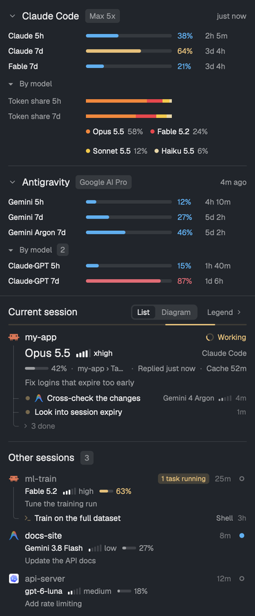
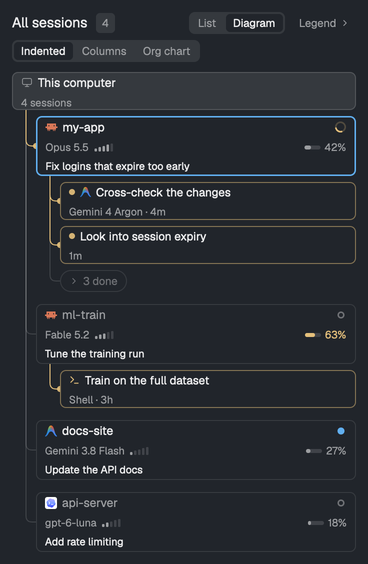

# Herdr Agent Panel

**English** | [한국어](README.ko.md)

Mods for the Herdr desktop app that add **AI plan usage** and **each session's model** to the right-side panel, so you can see both at a glance. Built for people who use Claude Code and Antigravity (agy) side by side.

> The panel uses English or Korean, following your macOS language settings: Korean if set as your first preferred language, English otherwise.



Switch the sessions list to **Diagram** to see the same sessions as a map, with what each one started. Pick a layout with the buttons under the header: Indented (shown), Columns or Org chart.



## Mods

| Mod | What it does |
|---|---|
| [`ai-usage`](ai-usage/) | Shows Claude Code's 5-hour and 7-day limits, its per-model weekly limits (such as Fable), and Antigravity's Gemini and Claude/GPT limits as bars. Expand "By model" to see each Claude model's share of tokens. Click a section's title to fold it down to one line. Both sections keep refreshing even when Claude Code and agy are closed. |
| [`sessions`](sessions/) | Shows the model, reasoning effort and context usage of the current session, lists your other sessions and their running sub-agents as a tree, and adds a line on what each session is doing right now. A sub-agent's model is shown only when it differs from its parent's. Commands still running in the background after the agent has replied (such as a training script) are shown too. Switch from List to Diagram to see the same sessions as boxes joined by lines, in one of three layouts. |
| [`tabs-flow`](tabs-flow/) | Adds a **Flow** button to Herdr's default tab bar and opens this panel automatically whenever you switch spaces. |

They are built to work together, but each one can be installed on its own.

## Requirements

- Developed and tested on Herdr desktop app 0.1.16.
- macOS (the scripts use macOS commands such as `stat -f` and `ps`), `python3`, and `jq`.
- `ai-usage`
  - Claude Code with a Pro or Max subscription: usage is only shown for subscription plans.
  - The Antigravity section appears only if the Antigravity CLI (`agy`) is installed. The panel runs `agy` from your home folder to check usage, so agy must trust that folder: run `agy` there once and choose to trust it.
- `sessions`: model, effort and sub-agent details are read from the cache that the [herdr-over9k](https://github.com/herunan/herdr-over9k) sidebar writes, so install the over9k sidebar first.

## Installation

1. Copy the mod folders into Herdr's config folder (`~/.config/herdr-app/mods/`).

   ```sh
   cp -R ai-usage/mods/ai-usage sessions/mods/sessions tabs-flow/mods/tabs-flow ~/.config/herdr-app/mods/
   ```

2. Add the panel to a custom layout. Herdr's default layouts can't be edited directly, so clone one first.

   ```sh
   herdr-app do layout.clone '{"name":"main","as":"my-main"}'
   ```

   Then make two changes in `~/.config/herdr-app/layouts/my-main.json`:

   - Tab bar: in the block with `"id": "tabs"`, change `"mod": "tabs"` to `"mod": "tabs-flow"`.
   - Panel: add this node to the `children` of the `"id": "panel-body"` stack.

   ```json
   { "id": "flow", "type": "column", "children": [
     { "id": "usage", "type": "block", "content": { "mod": "ai-usage" }, "size": { "px": 330 } },
     { "id": "flow-main", "type": "block", "content": { "mod": "sessions" }, "size": { "weight": 1 } } ] }
   ```

   `"px": 330` is only the starting height; the `usage` block resizes itself to fit its content.

   To choose the language yourself, add `"props": { "lang": "en" }` (or `"ko"`) next to `"mod"` in the `content` of the `usage` and `flow-main` blocks, as in `"content": { "mod": "ai-usage", "props": { "lang": "en" } }`.

3. (Optional) Set up the status line scripts. `ai-usage` already asks Claude Code and agy for usage on its own; with these scripts, the bars also update the moment an open session refreshes and the Antigravity section shows your plan name.

   - **Claude Code**: copy [`extras/claude-statusline-usage.sh`](ai-usage/extras/claude-statusline-usage.sh) to `~/.claude/` and add this to `~/.claude/settings.json`. If you already have a status line script, you can instead add just the part at the top that saves stdin to `~/.claude/state/statusline-latest.json`.

     ```json
     "statusLine": { "type": "command", "command": "~/.claude/claude-statusline-usage.sh", "refreshInterval": 30 }
     ```

   - **Antigravity**: copy [`extras/agy-statusline-usage.sh`](ai-usage/extras/agy-statusline-usage.sh) to `~/.gemini/antigravity-cli/` and add this to `~/.gemini/antigravity-cli/settings.json`. With `stack_with_default`, agy's own status line stays as it is.

     ```json
     "statusLine": { "type": "command", "command": "sh \"$HOME/.gemini/antigravity-cli/agy-statusline-usage.sh\"", "stack_with_default": true }
     ```

     If `$HOME` isn't expanded in your setup, write the full absolute path instead.

4. Check the mods and switch to the layout.

   ```sh
   herdr-app check ~/.config/herdr-app/mods/ai-usage
   herdr-app check ~/.config/herdr-app/mods/sessions
   herdr-app check ~/.config/herdr-app/mods/tabs-flow
   herdr-app do layout.switch '{"name":"my-main"}'
   ```

Back up your config files before editing them. If the layout breaks, press `ctrl-alt-shift-escape` to go back to the default layout.

## Where the data comes from

Everything is read locally on your computer; nothing is sent anywhere.

| Item | Source | Refresh |
|---|---|---|
| Claude 5-hour and 7-day limits | `claude -p "/usage"` (below), or the file saved by Claude Code's status line, if newer | 30 seconds |
| Claude per-model weekly limits (e.g. Fable 7-day) | `claude -p "/usage"`. It calls no model, so it uses no tokens, and it leaves no session record (`--no-session-persistence`). | 30 seconds |
| Token share by model | Conversation logs in `~/.claude/projects` (sub-agents included, cache reads excluded). Only new lines are read. | 30 seconds |
| Antigravity limits | `agy -p "/usage"` run in your home folder (no model call; log discarded via `--log-file /dev/null`), or the file saved by agy's status line, if newer. | 1 minute |
| Sessions and sub-agents | Herdr's `agents()` and `terminals()`, and the over9k cache | 5 seconds |
| What each session is doing | The end of Claude Code's conversation log (`tail`); for Codex and Antigravity, the session title | 5 seconds |
| Background work | The cache over9k builds from conversation logs (`~/.cache/over9k/tasks-*`) | 5 seconds |

You can change the intervals in the `cx.timer.every(...)` calls in each `main.js`.

## Good to know

- **The token share is an estimate.** It counts tokens without cache reads, so it can differ from how fast each limit is actually used up.
- **Antigravity's Claude and GPT models share a single limit.** agy counts both in a single `3p` bucket, so they can't be shown separately.
- **"What it's doing" is the agent's own words**, not a separate summary: for Claude Code, the description of its latest step or the first line of what it last wrote. It costs no tokens.
- **A session's name is the folder it was started in.** The home folder shows as `~`; hover over the name to see the original session title.
- **`sessions` depends on over9k.** Without it, the model appears as "Model unknown".
- **Codex sessions** haven't been tested much in real-world use.

## License

- Code in this repo: [MIT](LICENSE)
- `tabs-flow` is a modified copy of the Herdr app's default `tabs` mod and is under the [Apache License 2.0](tabs-flow/LICENSE).
- Code taken from other projects is listed in [THIRD-PARTY-NOTICES.md](THIRD-PARTY-NOTICES.md).

This is an unofficial project and is not affiliated with Herdr, Anthropic, Google or OpenAI. Product names and logos are trademarks of their respective owners.
