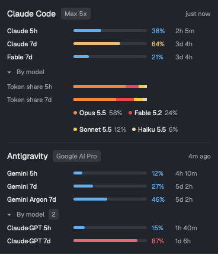

# AI Usage

A panel block that shows how much of your Claude Code and Antigravity plans you have used: one bar per limit with the time left until it resets, Claude's per-model weekly limits (such as Fable), and, collapsed under "By model", each Claude model's share of tokens across the current windows. The labels are in English or Korean, following your macOS language setting.

## What you see

Top to bottom, 12px padding, on the theme `background`, with a 1px `border` line at the bottom:

1. **Claude Code section.** A 14px semibold title "Claude Code", a small gray pill with the plan ("Max 5x"), and on the right how long ago the data was updated ("just now", "3m ago").
   - Rows, 18px tall, 11px text, in fixed columns: label (104px) · bar (flexible, 5px tall, rounded, `raised` track) · percent (32px) · time to reset (60px, muted, e.g. "2h 5m").
   - "Claude 5h", "Claude 7d", then one row per model limit that Claude Code's `/usage` reports, e.g. "Fable 7d".
   - Bars are `accent`, `working` from 60% and `blocked` from 85%.
   - A collapsible row "▸ By model". When expanded, it shows "Token share 5h" and "Token share 7d": stacked bars split by model, and a legend with a dot, the model name and its share. Model colors: Fable `#e5484d`, Opus `#f0883e`, Sonnet `#f2c94c`, Haiku `#e6d5a8`.
2. **A 1px divider.**
3. **Antigravity section.** Title "Antigravity" and the plan pill ("Google AI Pro").
   - Rows for every Gemini bucket agy reports: "Gemini 5h", "Gemini 7d", and per-model ones such as "Gemini Argon 7d".
   - A collapsible row "▸ By model 2" holding the buckets agy runs Claude and GPT on: "Claude·GPT 5h", "Claude·GPT 7d".

Empty states: "Shows up after you run Claude Code once", "Shows up after your first chat in agy".

In Korean the same screen reads "Claude 5시간", "Fable 7일", "모델별", "토큰 비중 5시간", "방금" and so on. All labels for both languages live in one `TEXT` table in `main.js`.

## How it behaves

- The block resizes itself to its content (`layout.resize` on its own layout node), so collapsing a section gives the space back to the block below.
- Fold states are remembered per block instance in `localStorage`.
- Language: `props().lang` (`"en"` or `"ko"`) if set; otherwise Korean when the first entry of `defaults read -g AppleLanguages` starts with `ko`, English for anything else. The last detected language is kept in `localStorage`, so the block opens in that language before the check finishes.
- A window whose reset time has passed shows 0% until new data arrives.
- Refresh: the status line files are watched (`watchFolder`) and updates appear immediately; `/usage` and the token split run every 30 seconds; countdowns redraw every 30 seconds.

## Built from

- `mods/ai-usage/main.js`: the view. `herdr` functions: `home`, `appHome`, `readTextFile`, `watchFolder`, `exec`, `theme`, `checking`, `layout`, `settings`, `run`. Command: `layout.resize`.
- `mods/ai-usage/plan-usage.py`: runs `claude -p "/usage" --no-session-persistence --output-format json` (no model call, no tokens) and parses lines like `Current week (Fable): 6% used · resets Nov 29 at 7am (Asia/Seoul)`.
- `mods/ai-usage/model-usage.py`: sums input + cache-creation + output tokens per Claude model per hour from `~/.claude/projects/**/*.jsonl` (sub-agents included), reading only new lines (cache in `~/.cache/ai-usage/`).
- Data files written by the status line scripts in `extras/`:
  - `~/.claude/state/statusline-latest.json` (Claude Code `rate_limits`)
  - `~/.cache/agy-statusline/latest.json` (agy `quota`, `plan_tier`)
- The plan pill for Claude comes from `oauthAccount.organizationRateLimitTier` in `~/.claude.json`.
- `props().demo` renders fixed mock numbers for screenshots instead of live data, with both sections expanded; `props().open` (for example `{"claude": false}`) overrides which sections are open, and `props().width` sets a fixed width. A demo copy reads no files, runs no commands, and leaves the layout untouched; it uses `props().lang`, English by default.

## Watch out

- Claude Code's status line JSON has no per-model limits; only `/usage` shows them. Don't infer Fable's limit from the token split.
- `/usage` prints reset times both as `6:59am` and, on the hour, as `7am`. Parse both.
- agy sends `quota` only after the first request of a session; keep the last quota when a status line arrives without one.
- Two reads of the same agy bucket can disagree; the agy script keeps, per bucket, the later reset window and, within one window, the higher usage.
- Claude Code writes one log entry per content block of a reply with the same message ID; count each ID once.
- macOS only as written (`stat -f`).
- The mod runtime has no `Intl` and no `navigator`, so the language comes from `defaults`, not from JavaScript.

## Done when

- `herdr-app check mods/ai-usage` passes.
- With a Claude Code session running, the Claude rows show the same percentages as Claude Code's `/usage`, and a Fable row appears when `/usage` lists one.
- Opening "By model" grows the block and closing it shrinks it, with no gap or clipping.
- After one agy request, the Antigravity rows show the Gemini buckets, and the Claude·GPT rows sit inside the fold.
