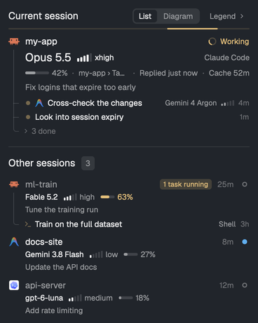

# Sessions

A panel block that shows, for every coding-agent session, which model it runs, its reasoning effort and what it is doing right now: the current session prominently at the top, every other session below, and under each one a tree of the sub-agents it started. A List / Diagram switch shows the same sessions as a diagram instead, drawn in one of three layouts. The labels are in English or Korean, following your macOS language setting.

## What you see

1. **Current session**, with a "List | Diagram" switch (two 18px buttons on a `raised` pill, the shown one on `background`; the same English words in Korean) and a "Legend ›" toggle (Korean "범례") on the right that opens a short legend.
   - Line 1: program icon, the session's name (the folder it was started in; `~` for home), and its status on the right ("Working" with a spinner while working).
   - Line 2: the model in 16px semibold ("Opus 5.5"), a five-step effort meter with its label ("xhigh"), an "ULTRACODE" badge when that mode is on, and the program name on the right.
   - Line 3: a small context meter with its percentage, "space › tab", the time since its last reply, and how long its prompt cache lasts.
   - Line 4, muted 11.5px: **what it is doing now** (see How it behaves). Hover for the whole line.
   - While the session is working, a short pulse of light runs left to right along a 2px line under the header, restarting from the left every 1.6 seconds.
2. **Other sessions** with a count. Each session takes up to three lines: name, relative time and a status dot; model, effort meter and context meter, with the space name on the right when it differs from the folder name; then what it is doing now. Sessions awaiting your input come first, followed by working, done, and idle, newest first within each group.
3. **Sub-agent tree** under each session: a 1px guide rail from the parent's icon, one line per sub-agent (status dot, name, model, effort meter, elapsed time). A sub-agent's model shows only when it differs from its parent's; the tooltip always has it. Running ones are bright; finished ones fold into "N done".
4. **Background work.** Commands that a Claude Code session left running in the background (such as a training script or a monitor) appear on their own lines in the session's tree with their elapsed time. The session also shows an "N tasks running" badge ("N scheduled" when only scheduled prompts remain) even when the agent itself is idle. These sessions sort above idle ones.
5. **Diagram** (in place of 1–4, under the title "All sessions", Korean "전체 세션", with a count), with a row of three layout buttons under the header: "Indented" (default, Korean "계단형"), "Columns" ("가로형") and "Org chart" ("조직도").
   - A box for this computer ("This computer", Korean "이 컴퓨터", monitor icon, "N sessions"; a remote machine gets its own box with a server icon and its name), then the sessions (current first, then the list's order), then what each started, its sub-agents and background tasks, and their own children.
   - Indented: each box under the one before it, 24px further in per level and nearly the panel's full width; lines run down the parent's rail (under its icon) and turn into the child with a 6px rounded corner. Columns: one column per level left to right (the machine box 88px, 124px in English), the rest sharing the width. Org chart: one row per level, a parent centred over its children, each leaf at least 96px across; wider than the panel, it scrolls sideways.
   - Session boxes are 60px tall with three lines (name and status; model with effort meter, and the context meter when the box is at least 150px wide; what it is doing now). Other boxes are 38px with two lines (name; model or kind, and elapsed time).
   - Each box is joined to its parent by a 1px line, drawn in `working` when the child is running. The current session's box has a 1.5px `accent` border. Finished sub-agents fold into an "N done" pill, as in the list.
   - **What flows along the lines.** While a child works, a 5px ball in the line's color rolls through the line as through a pipe: out of the parent's box, along the line (down the rail and round the corner, or along the curve), into the child's box, once every 2.8s, easing in and out. When a child starts working (its parent handed work over) a brighter 6px one rolls the same way for 6s; when it stops (it answered) a `done`-blue one rolls back up for 6s. A child removed the moment it exits (`hc run --rm`) keeps its box for those 6s, so its answer shows.
   - The List | Diagram and layout buttons share one raised thumb that springs to the pick, overshooting a little before it settles.

## How it behaves

- **What it is doing now.** For Claude Code, the end of its transcript (`tail -c 262144`): the latest step as the agent described it (a command's or sub-agent's `description`, its in-progress to-do, or the first line of what it last wrote), or a new request it has not answered yet. For Codex and Antigravity, the title they give the session (Codex's thread, agy's conversation). A terminal still titled by its command line (`agy --dangerously-skip-permissions`) has no title yet.
- Clicking a session runs `agent.focus` on its terminal. Clicking a sub-agent that has its own terminal (started with `hc run`) runs `terminal.peek`.
- The diagram's boxes click the same way as the list's lines; the "N done" pill opens and closes the finished ones.
- The chosen view and layout are kept in `localStorage` (`view`, `shape`).
- Hovering a meter or badge explains it.
- It refreshes every 5 seconds and reads files only while visible on screen.
- Language: `props().lang` (`"en"` or `"ko"`) if set; otherwise Korean when the first entry of `defaults read -g AppleLanguages` starts with `ko`, English for anything else. The last detected language is kept in `localStorage`. All labels for both languages live in one `TEXT` table in `lib.js`.

## Built from

- `mods/sessions/main.js` (view, polling) and `mods/sessions/lib.js` (pure helpers, tested by `lib.test.mjs` with `node lib.test.mjs`).
- `herdr` functions: `agents`, `terminals`, `spaces`, `panes`, `focused`, `layout`, `props`, `settings`, `theme`, `run`, `exec`, `home`, `appHome`, `readTextFile`, `checking`. Commands: `agent.focus`, `terminal.peek`.
- The diagram's layouts, in `lib.js`: `stackTree` (Indented: each box's top and indent), `placeTree` (Columns: each box's column and row, a leaf taking the next row and a parent sitting level with the middle of its children, half a row between sessions) and `orgTree` (Org chart: `placeTree`'s rows turned on their side). Boxes are absolutely placed `div`s; the lines are one `PathBuilder.stroke(1)` per color drawn with `window.paint_path` under them, the running ones last.
- What a session is doing: `activity` in `lib.js` (Claude Code's transcript) and `commandTitle` (a title that is still a command line).
- What flows: each line's shape is defined once (`lineOf` in `main.js`: straight runs, a quadratic corner, cubic curves) and both drawn with `PathBuilder` and turned into points (`bezierPoints`, `resample` in `lib.js`). The ball is a relay of small `div`s, one per 6px of those points: each appears when the one before arrives, slides its step and shrinks away, all set in one render with transition delays, so two renders a pass keep it on the line however it bends. `talkEvents` decides who just spoke from each child's status against the last look.
- The toggles' thumb: each button's width from `on_size_change` (divided by `settings().zoom`), then `spring("left")` and `spring("width")` with `{ response: 340, damping: 0.62 }`.
- Sessions and their state come from `agents()`. Sub-agents started with `hc run` come from `terminals()` (`parent`).
- Model, effort, ULTRACODE mode, context and cache times for Claude Code come from the over9k sidebar's cache, `~/.cache/over9k/agents/<terminal>.json`. Claude Code's own sub-agents come from `~/.cache/over9k/subagents-<cksum of the transcript path>`, and its unfinished background commands from `~/.cache/over9k/tasks-<same cksum>` (over9k's `tasks.sh`: one task per line with tab-separated fields: kind, id, description, start time, schedule, output file).
- Antigravity details come from running over9k's `agy-info.py` and `agy-subagents.py` (read-only), only while an agy session is listed. Codex details come from its terminal title, or the defaults in `~/.codex/config.toml`.
- `props().demo` renders mock sessions for screenshots instead of live data, and clicks in a demo copy trigger no commands; `props().width` sets a fixed width, `props().lang` picks the language (English by default), `props().view` (`"list"` or `"diagram"`) the view and `props().shape` (`"indent"`, `"ltr"` or `"org"`) the layout.

## Watch out

- It depends on [herdr-over9k](https://github.com/herunan/herdr-over9k) being installed and on screen; without it, models appear as "Model unknown".
- `loop()` only swings a value back and forth. For a one-way sweep, the line is its own nested view (`cx.new`) that draws a new element at the left on each pass and moves it with `transition("left", ...)`, so only that view is redrawn.
- The over9k sub-agent file is named by the POSIX `cksum` of the transcript path; the JS implementation must match the system `cksum` output (see the test).
- The diagram's width comes from `on_size_change`, which reports window pixels: divide by `settings().zoom` before placing boxes.
- A transcript's last line can be a tool output bigger than the tail read; then the last known step stays.
- `cx.new()` returns a handle, not the view: fields set on it never reach the view (use `set_props`), which is why the balls are drawn by the panel itself.
- One element can't go through several targets in one render, and easing each axis differently only imitates a curve; the relay of elements is what keeps a ball on the line.
- The balls redraw the panel twice a pass (2.8s) while anything flows, and not at all otherwise.
- A new Claude Code session has no model until its first reply.
- Codex was checked with demo data only.

## Done when

- `herdr-app check mods/sessions` passes and `node mods/sessions/lib.test.mjs` prints `lib ok`.
- With over9k installed and a Claude Code session running, the current session shows its model and effort as Claude Code reports them, and its last line changes as the agent moves from step to step.
- Starting `hc run -- agy` from that session shows an Antigravity line in its sub-agent tree within about 10 seconds, with its model, since it differs from the session's.
- With Diagram chosen, a lone session shows as a "This computer" box joined to that session's box; `hc run --bg -- sleep 60` from that session adds a box under it (Indented) on a `working` line, and the three layout buttons redraw it each way.
- `hc run --bg --rm -- sleep 8` from that session: a bright ball rolls down to its box, softer ones follow while it runs, and when it ends a blue one rolls back up while the box stays a few seconds. Filmed frame by frame, the ball's track lies on the line in all three layouts.
