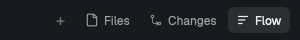

# Tabs Flow

Herdr's tab bar with one more side-panel button, **Flow**, next to Files and Changes. The Flow panel opens automatically whenever you enter a space, keeping the usage and sessions blocks in view.

## What you see

The shipped tab bar, unchanged, plus a "Flow" button with its own icon (`mods/tabs-flow/flow.svg`, three bars) after "Changes". It appears only when the active layout has a node with the id `flow` inside the `panel-body` stack.

## How it behaves

- Clicking Flow selects the `flow` child of `panel-body` and shows `panel`; clicking it again hides the panel, like Files and Changes.
- Entering any space opens the panel on Flow. If you close it or switch to Files or Changes, that state lasts only until the next space switch.

## Built from

A modified copy of the Herdr app's shipped `tabs` mod (`herdrdev/herdr-app`, `defaults/mods/tabs/`, Apache License 2.0). Two changes in `main.js`:

- `enabled` adds `"flow"` when `find(root, "flow")` exists, and a `panelButton("flow", "Flow", ...)` is drawn after Changes.
- `syncPanel` treats Flow as pinned: on a space switch it selects `flow` and shows `panel`.

Commands: `layout.select {stack: "panel-body", child: "flow"}`, `layout.show {id: "panel"}`, `layout.hide {id: "panel"}`.

## Watch out

- Keep the guard that shows the button only when the layout has a `flow` node; otherwise `layout.select` fails with `no stack "panel-body" with a child "flow"`.
- Because this is a modified copy, Herdr won't update it automatically; compare it with the shipped `tabs` mod after a Herdr update.

## Done when

- `herdr-app check mods/tabs-flow` passes.
- In a layout with a `flow` child in `panel-body`, the Flow button appears and toggles the panel.
- Switching to another space opens the panel on Flow.
